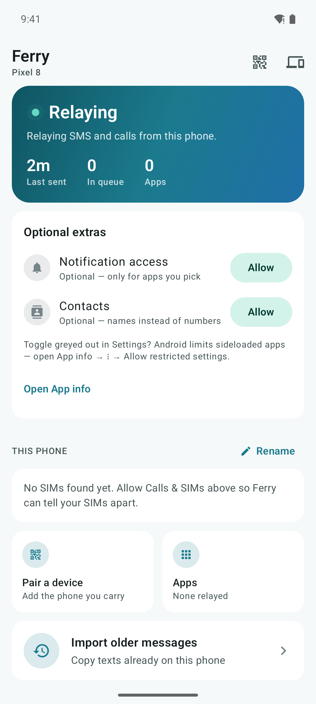
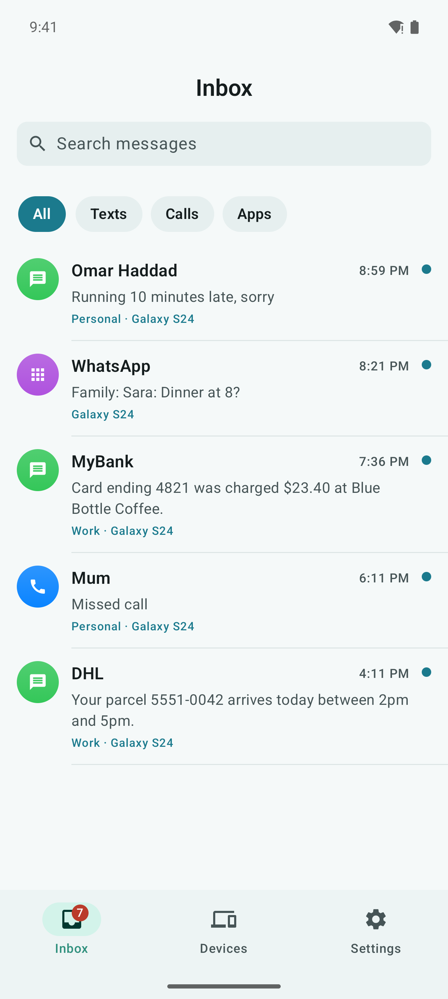
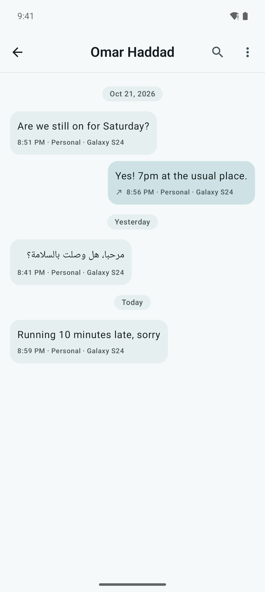
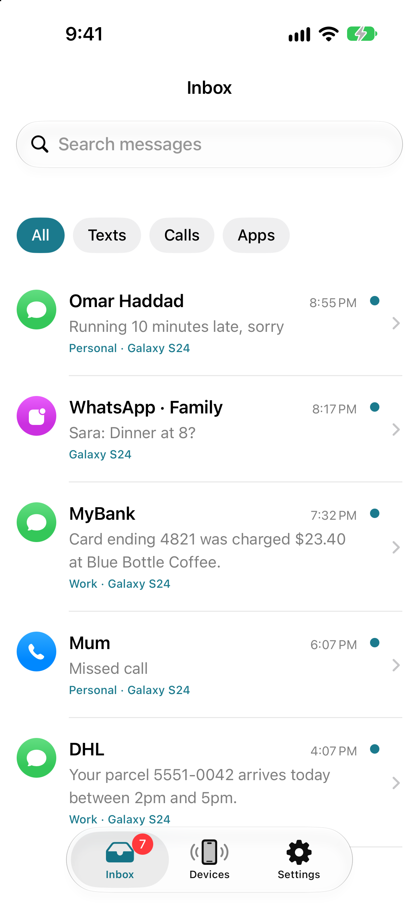
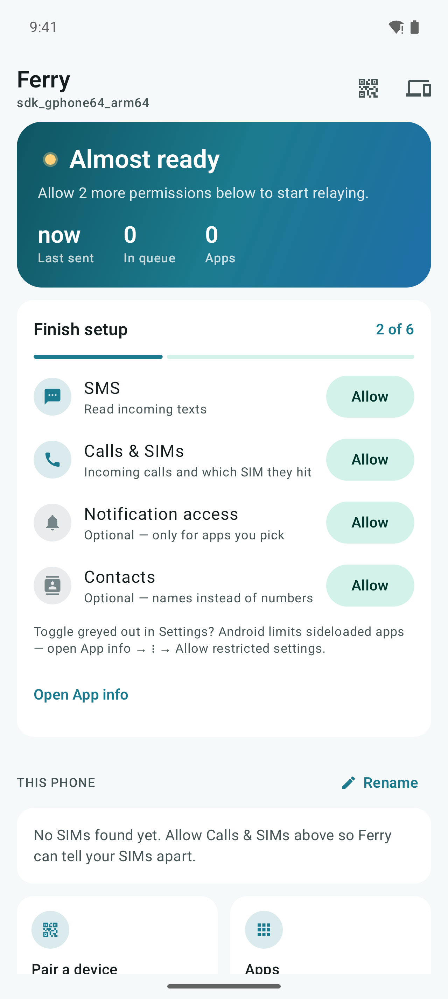
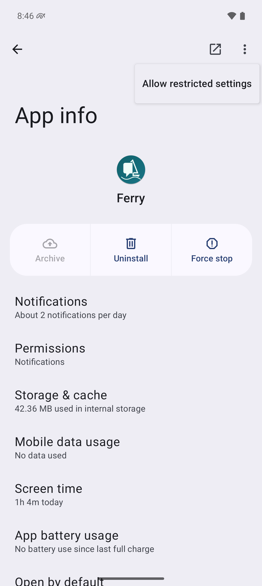
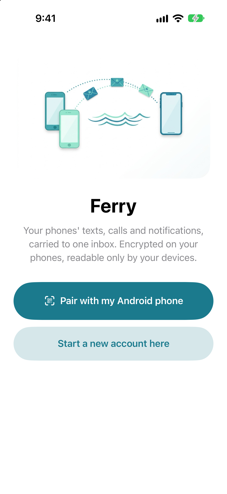

# Ferry

All your phones' texts, calls and notifications, carried to one inbox. End-to-end encrypted.

Have a second phone for work, travel or a local SIM? Ferry runs on it and relays its SMS, calls
and the app notifications you choose to the phone you actually carry: an iPhone, or another
Android phone. Everything is encrypted on the sending phone, and only your own devices hold the
key. The server in the middle only ever sees scrambled data.

<p>
  
  
  
  
</p>

## How it works

```
 Android phone with SIMs            Relay server                 Your iPhone / Android
 ───────────────────────            ────────────                 ─────────────────────
 reads SMS, calls,       encrypt    stores and forwards  push    decrypts with the key
 chosen notifications  ─────────▶   ciphertext only    ───────▶  only your devices have
```

- **Any number of phones and SIMs.** Every message is tagged with the phone and SIM it came in on.
- **Texts, calls and notifications.** Notifications are relayed only for the apps you turn on.
  The list is empty by default.
- **Pairing by QR code.** Your first device creates the account and the key. Each new device scans
  a code from one that's already set up.
- **Hosted or self-hosted.** Use Ferry Relay, or run your own server (see below).

## Privacy

| Who | Can see | Can't see |
|---|---|---|
| The relay server | that your devices exist, when events arrive, their padded size | message text, phone numbers, contact and app names, SIM details |
| Apple / Google push | that a push was sent | anything inside it |
| Your paired devices | everything | — |

Encryption is XChaCha20-Poly1305 with keys derived from a master key that never leaves your
devices. The full design and threat model are in [docs/PROTOCOL.md](docs/PROTOCOL.md).

All devices on an account share the key. If a phone is lost, remove it in **Devices**, then set
up the others again from a fresh account.

## Install

### Android (6.0 or newer)

Ferry isn't on Google Play: Google only allows SMS and call-log access for default messaging
apps. Install the APK instead:

1. Download the latest `ferry-*.apk` from [Releases](../../releases).
2. Open it and allow your browser or file manager to install apps when asked.
3. Open Ferry and choose what this phone does:
   - **It has the SIM cards:** it relays SMS, calls and chosen notifications.
   - **I read messages on it:** it receives and decrypts messages from your other phones.

#### Permissions Ferry asks for

On the relaying phone, Ferry walks you through these on its home screen:



| Permission | Why | Needed |
|---|---|---|
| SMS | Read incoming texts | Yes, on the relaying phone |
| Phone and call log | Incoming calls and which SIM they hit | Yes, on the relaying phone |
| Notifications | Show that Ferry is relaying, and show incoming messages | Yes |
| Run in background (battery) | Stop Android from pausing Ferry | Strongly recommended |
| Notification access | Relay notifications from the apps you pick | Optional |
| Contacts | Show names instead of numbers | Optional |
| Send SMS | Send the replies you write on your other phones | Optional |
| Camera | Scan the pairing code | Only while pairing |

#### Notification access on a sideloaded app

Android 13 and newer block notification access for apps installed outside an app store. The
switch is greyed out and says *Controlled by Restricted Setting*. To allow it:

1. In Ferry, tap **Notification access** once. Android shows *App was denied access*. Tap
   **Close**.
2. Open **Settings → Apps → Ferry** (or tap **Open App info** in Ferry).
3. Tap **⋮** in the top-right corner, then **Allow restricted settings**, and confirm with your
   PIN or fingerprint.
4. Go back to Ferry and turn on **Notification access**. It works now.



On Samsung the menu is under **Settings → Apps → Ferry → ⋮** as well. On Xiaomi (HyperOS/MIUI) it
may be under **App info → Other permissions**. If SMS or call permissions ever show the same
*restricted* message, the same steps fix it.

#### Keep Ferry running

Some phones stop background apps aggressively. Allow **Run in background** when Ferry asks.
On Samsung, Xiaomi, Huawei and OnePlus also check the manufacturer's own battery settings; see
[dontkillmyapp.com](https://dontkillmyapp.com) for your model.

### iPhone (iOS 18 or newer)

Ferry for iPhone is in beta on TestFlight: <!-- TODO: TestFlight link --> *link coming soon*.

Set up the Android phone first (**It has the SIM cards** → **Yes, start fresh**). It shows a code.
On the iPhone, tap **Pair with my Android phone** and scan it. The iPhone makes your encryption
key; the Android phone gets a key of its own and never sees yours.



## Self-hosting

The relay is a small Node server with Postgres. With Docker:

```sh
cp server/.env.example server/.env     # set DATABASE_URL, INVITE_CODE and push keys
docker compose -f server/docker-compose.yml up -d --build
```

Put it behind HTTPS, then choose **My own server** when creating your account. See
[server/README.md](server/README.md) for invites, push setup and deployment.

## Project layout

| Path | What | Stack |
|---|---|---|
| [docs/PROTOCOL.md](docs/PROTOCOL.md) | Wire protocol & crypto spec | — |
| [docs/test-vectors/](docs/test-vectors/) | Crypto test vectors every client must pass | JSON |
| [packages/crypto-ts/](packages/crypto-ts/) | Reference crypto implementation + vector generator | TypeScript, libsodium |
| [server/](server/) | Relay server | Fastify, TypeScript, Postgres |
| [android/](android/) | Relaying phone and receiver app | Kotlin, Jetpack Compose |
| [ios/](ios/) | Receiver app + Notification Service Extension | Swift, SwiftUI |

Each folder has its own README with build instructions. To run the crypto tests:

```sh
pnpm install
pnpm test            # runs crypto tests against docs/test-vectors
pnpm vectors         # regenerates docs/test-vectors/v1.json
```

Requires Node 24+ (TypeScript runs natively, no build step for tests).

To fill an account with demo messages (screenshots, App Store review), pair
[scripts/seed-demo.ts](scripts/seed-demo.ts) as an extra relaying device, then upload:

```sh
node scripts/seed-demo.ts pair 'ferry://pair?...'   # code made with "Relay its own SIMs"
node scripts/seed-demo.ts seed
```

### Identifiers

- Store name: `Ferry: SMS & Call Relay`. Home-screen name: `Ferry`
- App ID (Android & iOS): `tech.thedevlab.ferry`
- iOS notification extension: `tech.thedevlab.ferry.nse`
- iOS app group / keychain group: `group.tech.thedevlab.ferry`
- Hosted server (Ferry Relay): `https://ferry.thedevlab.cloud`

## Contributing

Bug reports, fixes and translations are welcome. Open an issue first for anything large. If
Ferry misbehaves on your phone, include the make, model and Android version.

Found a security problem? Please don't open a public issue; see [SECURITY.md](SECURITY.md).

## License

Copyright © 2026 MEA-23. See [NOTICE](NOTICE).

| Path | License |
|---|---|
| [android/](android/) | [GPL-3.0](https://www.gnu.org/licenses/gpl-3.0.html) |
| [ios/](ios/) | [MPL-2.0](https://mozilla.org/MPL/2.0/) |
| [server/](server/) | [AGPL-3.0](https://www.gnu.org/licenses/agpl-3.0.html) |
| [packages/crypto-ts/](packages/crypto-ts/) | [Apache-2.0](https://www.apache.org/licenses/LICENSE-2.0) |
| [docs/PROTOCOL.md](docs/PROTOCOL.md) | CC-BY-4.0 |

Each folder has its own `LICENSE` file. Contributions are accepted under the license of the
folder they change.

"Ferry" and the Ferry logo are not covered by these licenses. Forks must use a different name
and icon.
